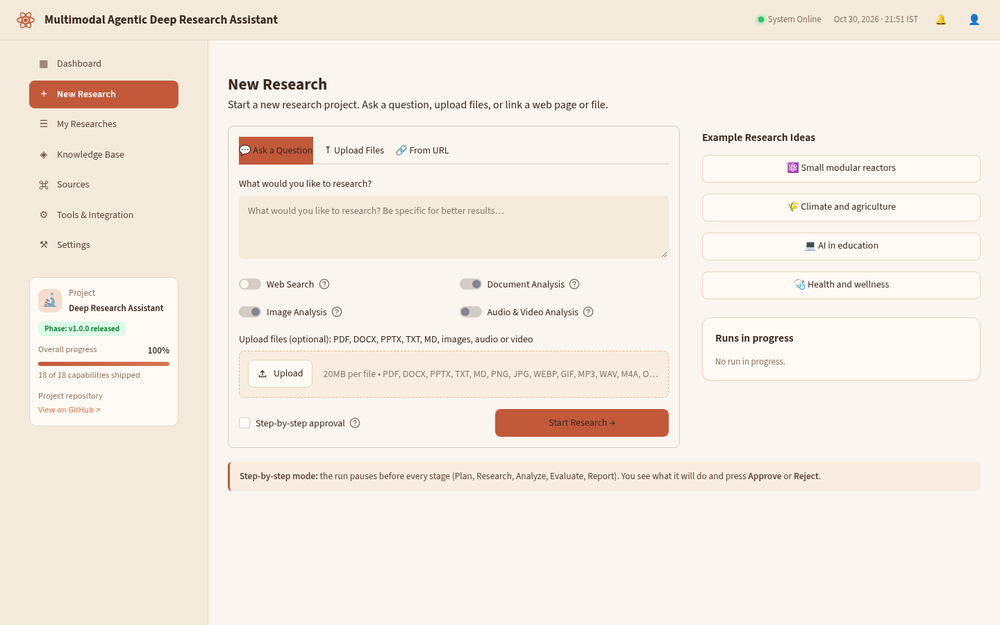
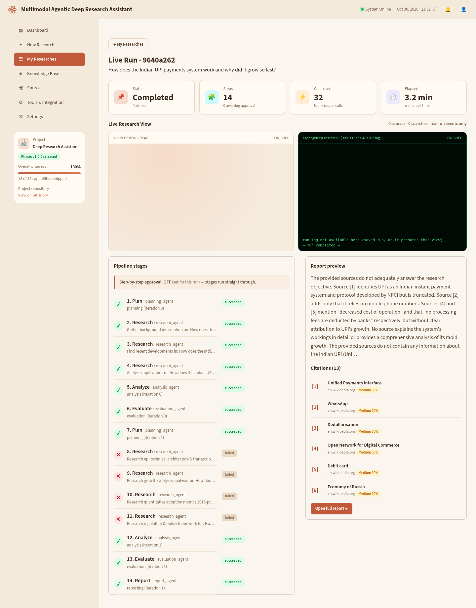
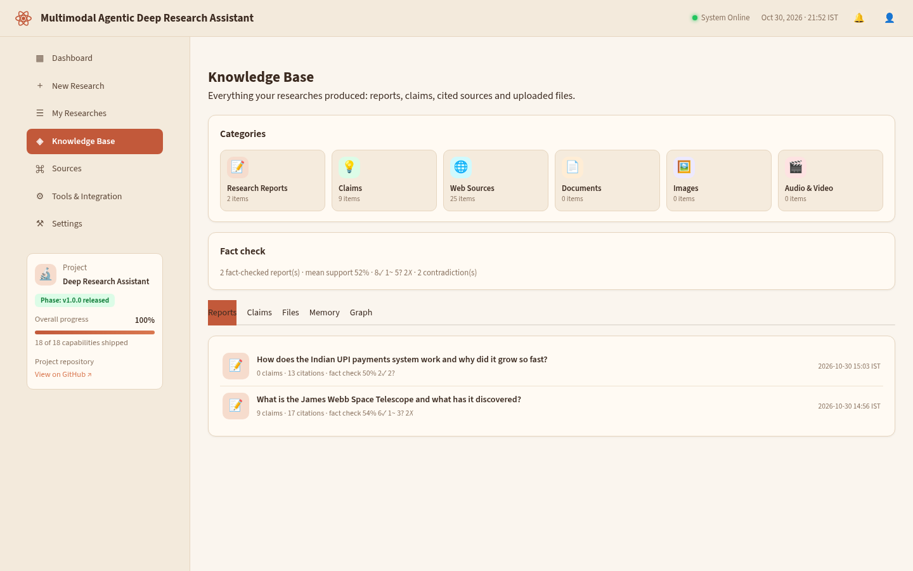
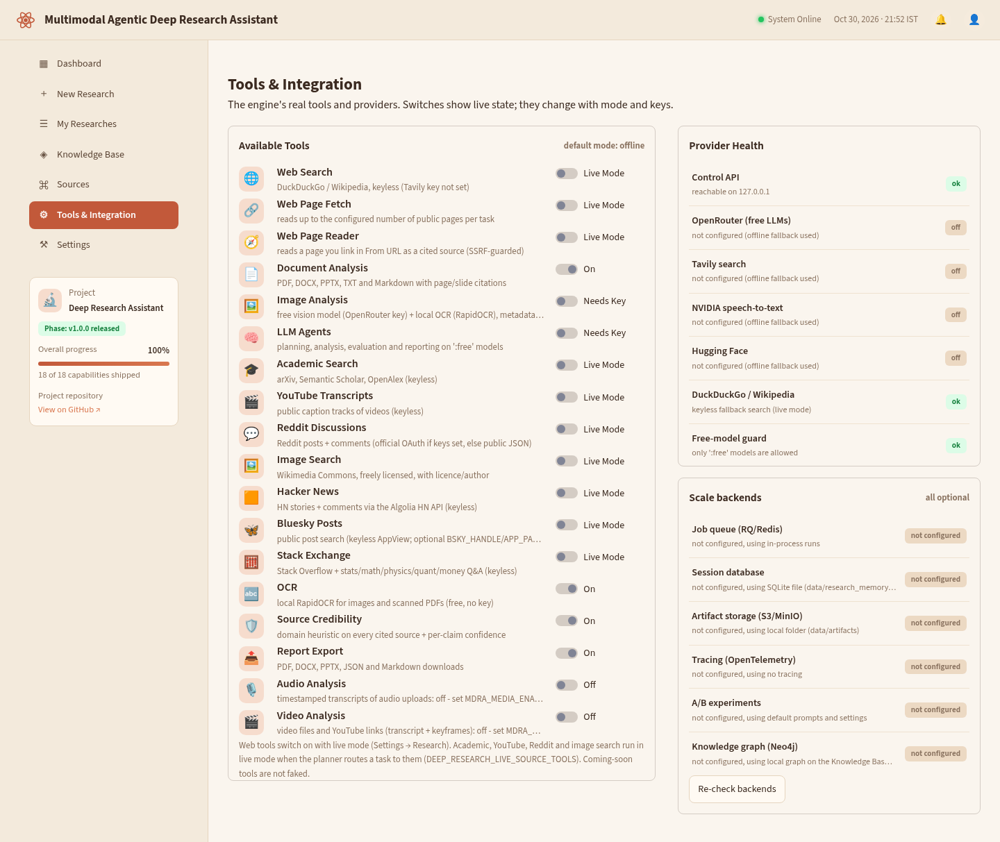
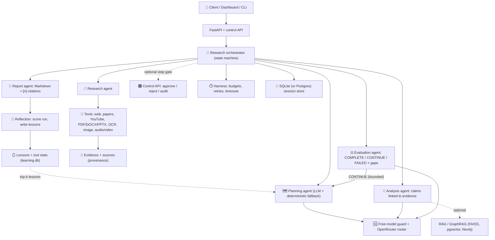

<div align="center">

# 🔬 Multimodal Agentic Deep Research Assistant

**An agentic research engine that plans, searches, reads PDFs, images, audio and video, writes cited reports, checks its own work, and learns from every run. It uses free models only.**

[](https://github.com/LeelaissakAttota/multimodal-agentic-deep-research-assistant/actions/workflows/quality.yml)

[](https://github.com/LeelaissakAttota/multimodal-agentic-deep-research-assistant/releases/tag/v1.0.0)

[](LICENSE)


[🏗️ Architecture](docs/ARCHITECTURE.md) · [🌐 Live mode](docs/LIVE_MODE.md) · [🎛️ Control API](docs/CONTROL_API.md) · [🎬 Demo guide](docs/DEMO.md) · [🪟 Windows setup](docs/SETUP_WINDOWS.md) · [📈 Scaling](docs/SCALE.md)

</div>

---

You give it a research question, and optionally PDFs, documents, images, web pages, audio or video. It plans the research, runs the right tools, collects evidence, writes a Markdown report with numbered `[n]` citations, and then judges whether the report is good enough. If it is not, it replans and goes again, within strict budgets. After every run it reflects, stores a few validated lessons, and uses them on the next similar question. Offline mode needs no keys and makes no network calls; live mode uses free OpenRouter models and free search sources.

## 🎯 The problem it solves

"Deep research" assistants are easy to demo but hard to trust. They can loop without end, make up sources, leak keys into logs, or quietly run up a paid API bill. This project treats research as a bounded, auditable workflow:

- 🔗 every claim links back to evidence, and every piece of evidence links back to a source
- 🧱 every loop has a limit: research iterations, tool and model calls, tokens, time, and retries
- 🆓 every model call goes through a guard that allows only `:free` models
- 🧑‍⚖️ a human can supervise a run step by step and approve or reject each step before it runs

## 📸 See it working

| 🏠 Dashboard | 📝 Report view |
| --- | --- |
|  |  |
| Recent runs, sources, capabilities and quick actions. | Report, claims linked to evidence, verification and exports. |

| ➕ New research | 📡 Live run |
| --- | --- |
|  |  |
| Ask a question, upload files or link a page; optional step-by-step approval. | Every stage (plan → research → analyze → evaluate → report) with its status and the cited sources. |

| 📚 Knowledge base | 🧰 Tools & integration |
| --- | --- |
|  |  |
| Reports, claims, sources, files, memory and the knowledge graph. | Every tool and optional backend with its real status. |

**🪞 Identity & Learning**


The agent's fixed identity, the lessons it learned from earlier runs, and the score of completed runs without vs with those lessons (failed runs are listed but not averaged).

<details>
<summary>🔌 REST API screenshots (Swagger UI)</summary>

| Swagger UI | `POST /research` |
| --- | --- |
|  |  |

| `GET /research/{session_id}` | Validation (422) |
| --- | --- |
|  |  |

</details>

## ✨ Features

| | Feature | What it does |
| --- | --- | --- |
| 🤖 | **Agent pipeline** | Five agents (planning, research, analysis, evaluation, report) coordinated by an explicit state machine. The evaluator returns COMPLETE, CONTINUE or FAILED plus the gaps it found; CONTINUE triggers a bounded replan. |
| 🛟 | **LLM agents with deterministic fallback** | `LlmPlanningAgent` and `LlmEvaluationAgent` strictly validate the model's JSON. On a rate limit, timeout, invalid JSON or schema error, the deterministic agent makes that one decision and the decision log records it. |
| 🌐 | **Live research on free sources** | Search with automatic fallback (optional Tavily, DuckDuckGo HTML and Lite, Wikipedia, DuckDuckGo Instant Answer). Pages are fetched with SSRF and size protection. |
| 🎓 | **Public research sources (keyless)** | arXiv / Semantic Scholar / OpenAlex papers, YouTube transcripts, Reddit, Hacker News, Stack Exchange, Bluesky and Wikimedia Commons images, routed by the planner with web-search fallback. |
| 🖼️ | **Multimodal inputs** | PDF, DOCX, PPTX, TXT and Markdown (zip-bomb and XML-entity safe, page/slide citations), local OCR with RapidOCR, image description with a free vision model, web page URLs, and optional audio/video/YouTube analysis cited by `mm:ss`. |
| 🧠 | **RAG & GraphRAG** | Optional hybrid BM25 + vector retrieval (local FAISS/numpy or pgvector) for report chat and the knowledge base; GraphRAG expands hits through contradicting, shared-source and shared-entity claims, with optional Neo4j. |
| 🪞 | **Identity & Learning** | A fixed, human-owned identity plus self-improvement: every run is scored, reflected on, and turned into validated lessons that steer the next runs. |
| 🆓 | **Automatic free-model selection** | Reads the OpenRouter catalog, keeps only `:free` models, probes candidates and caches the fastest; `FreeModelGuard` rejects any model that is not free. |
| ✅ | **Trust signals** | Heuristic source credibility and per-statement confidence (heuristics, not fact checks). |
| 📤 | **Exports & CLI** | PDF, DOCX, PPTX, JSON, Markdown or self-contained HTML; a `deep-research` CLI runs one question end to end. |
| 💬 | **Assistant features** | Grounded follow-up chat on a report, a user profile the planner applies, notes and reminders, revocable read-only share links. |
| 🎛️ | **Supervised control** | Token-protected local API to start, pause, resume and stop runs and approve, reject or retry steps, with an audit log. |
| 📊 | **Dashboard** | Streamlit UI: Dashboard, New Research, My Researches, Knowledge Base, Sources, Tools & Integration, Identity & Learning, Settings. |
| 📈 | **Optional scale backends** | RQ on Redis, Postgres sessions, MinIO/S3 artifacts, OpenTelemetry tracing, A/B experiments, a knowledge graph with Neo4j sync, and a Chrome MV3 extension. All off by default. |
| 🔒 | **Safe operations** | Secret redaction in logs, 422 responses that never echo input, transactional SQLite persistence and recovery, retries, timeouts, budgets and an emergency stop. |

## 🛠️ Tech & skills used


**Skills shown:** agentic system design, multi-agent orchestration with bounded loops, LLM output validation with deterministic fallback, retrieval-augmented generation and GraphRAG, multimodal ingestion (documents, OCR, vision, speech, video), self-improvement through reflection, API design and input hardening, observability and tracing, secure secret handling, and test-driven development with CI.

## ⚙️ How it works



**Step by step**

1. 🗺️ **Plan:** the planning agent splits the question into research tasks, using your profile and the most relevant lessons from earlier runs.
2. 🔎 **Research:** the research agent runs the right tools (independent tasks run concurrently) and collects evidence with full provenance; attachments are cited first.
3. 🧠 **Analyze:** the analysis agent turns evidence into claims, each linked to its evidence IDs.
4. ⚖️ **Evaluate:** the evaluation agent returns COMPLETE, CONTINUE (with gaps, triggering a bounded replan) or FAILED.
5. 📝 **Report:** the report agent writes Markdown with `[n]` citations, source credibility and claim confidence; if the time budget is nearly used up, it reports from the evidence already gathered.
6. 🔁 **Reflect & learn:** the run is scored 0–100 and turned into 1–3 validated lessons that steer the next similar run.

Research iterations, tool retries, model fallback and recovery are separate loops, each with its own limit. See [docs/ARCHITECTURE.md](docs/ARCHITECTURE.md) and [docs/DECISIONS.md](docs/DECISIONS.md).

### ⚖️ Design decisions and tradeoffs

| Decision | Why it helps | Tradeoff |
| --- | --- | --- |
| Free models only, enforced by a guard | Mistakes can never cost money | Free models are slower and rate-limited, so fallback is required |
| Deterministic fallback for every LLM decision | A run always finishes, even when the model fails | Fallback decisions are simpler than LLM ones |
| Hard limits on every loop | No endless loops or surprise bills | Very broad questions may hit the limits |
| Attachments cited before web results | The user's own documents come first | Weak attachments can crowd out better web sources |
| Offline deterministic test suite | Fast, free and reproducible CI | Live behaviour is checked with opt-in live tests, not in CI |

## 🚀 Quick start

> 🪟 **Windows:** see [docs/SETUP_WINDOWS.md](docs/SETUP_WINDOWS.md) for a PowerShell step-by-step guide.

```bash
git clone https://github.com/LeelaissakAttota/multimodal-agentic-deep-research-assistant.git
cd multimodal-agentic-deep-research-assistant
python -m venv .venv && . .venv/bin/activate   # Windows: .venv\Scripts\Activate.ps1
python -m pip install -e ".[test,dashboard]"   # add ,export,ocr for report exports and local OCR
cp .env.example .env          # optional; offline mode needs no keys

deep-research-demo            # offline, deterministic demo (JSON output)
uvicorn deep_research.api.main:app --host 127.0.0.1 --port 8000
# open http://127.0.0.1:8000/docs
curl -X POST http://127.0.0.1:8000/research -H "Content-Type: application/json" -d @examples/sample_request.json

# Dashboard: control API on :8711 + Streamlit UI on :8502 (Windows: scripts\start-dashboard.ps1)
scripts/start-dashboard.sh    # then open http://127.0.0.1:8502
```

### 🌐 Live mode (free)

```bash
export DEEP_RESEARCH_RESEARCH_MODE=live
export DEEP_RESEARCH_OPENROUTER_API_KEY=...      # free OpenRouter key; models are chosen automatically
uvicorn deep_research.api.main:app --port 8000
```

Without an OpenRouter key, live mode still returns real search evidence, with a snippet summary in place of the synthesis. Full details, including model selection, the search chain, PDF and image limits, and report sections, are in [docs/LIVE_MODE.md](docs/LIVE_MODE.md).

### Attachments

`POST /research` accepts up to 5 attachments, each `{"kind": "pdf" | "image" | "document" | "url", "data": "...", "name": "optional"}`. For files, `data` is `data:<mime>;base64,...` (`document` covers DOCX, PPTX, TXT and Markdown). For `url`, `data` is a public `http(s)` page link; it is read in live mode only, through the same SSRF guard as web fetches (private and loopback addresses and redirects to them are refused). Images and scanned PDFs are OCR'd locally when `pip install -e ".[ocr]"` is installed (`DEEP_RESEARCH_OCR=off` disables it). Ready-made requests with a fictional PDF and chart are in [examples/demo-data](examples/demo-data/README.md).

### 💻 Command line

```bash
pip install -e ".[export]"                  # fpdf2, python-docx, python-pptx for --export pdf|docx|pptx
deep-research run "How do SMRs compare on cost?" --mode live \
    --file notes.docx --file https://www.energy.gov/ne/benefits-small-modular-reactors-smrs \
    --export pdf --export json --out reports/
```

`--file` takes a PDF, image, DOCX, PPTX, TXT/MD path or a web page URL (repeatable, max 5). `--mode` is `offline` (no network) or `live`. The Markdown report goes to stdout (or the full result with `--json`); status goes to stderr; the exit code is 0 only for a completed run.

### Exports

Finished runs export as `pdf`, `docx`, `pptx`, `json`, `md` or `html` (self-contained, inline CSS, no scripts): from the report page in the dashboard, with `GET /control/runs/{id}/export?format=pdf` on the control API, or with `deep-research run ... --export pdf`. Exports include the report body and tables, numbered sources with credibility, and claim confidence. A missing optional library returns 501 with the pip command.

### Supervised control

```bash
export DEEP_RESEARCH_CONTROL_TOKEN="$(python -c 'import secrets;print(secrets.token_urlsafe(32))')"
deep-research-control --port 8711     # binds to 127.0.0.1 only
```

See [docs/CONTROL_API.md](docs/CONTROL_API.md) for the endpoints, approval gates and key handling.

### Assistant: follow-up chat, profile, notes, reminders, sharing

On a report page in the dashboard: **Ask this report** (grounded Q&A with citations; unsupported questions are refused), **Notes & reminders**, and **Share** (HTML download, or a read-only link `http://127.0.0.1:8711/share/<id>?token=...` that you can revoke). **Settings → Profile & Preferences** sets saved topics, preferred/blocked sources, blocked domains and default depth (quick / standard / deep) for every new run; **Dashboard** lists upcoming reminders. Reminders are local only: nothing is emailed or pushed. Data lives in `data/assistant.db` (override with `DEEP_RESEARCH_ASSISTANT_DB`). Details: [docs/ASSISTANT.md](docs/ASSISTANT.md).

### 🧩 RAG chat, media, GraphRAG and run traces (all opt-in)

| Feature | Turn it on | What you get |
|---|---|---|
| Hybrid RAG chat | `MDRA_RAG_ENABLED=true`, `rag` extra, `deep-research rag-backfill` | BM25 + vector retrieval (local FAISS/numpy or pgvector) for "Ask this report" and the Knowledge Base, with `[n]` citations |
| Audio / video / YouTube | `MDRA_MEDIA_ENABLED=true`, `media` extra | faster-whisper transcripts or YouTube captions, keyframes captioned by a free vision model, cited by `mm:ss` |
| GraphRAG | `MDRA_GRAPH_RAG=true` (Neo4j optional via `MDRA_NEO4J_URI`, `graph` extra) | chat hits expanded through contradicting, shared-source and shared-entity claims; local graph fallback |
| Trace timeline | `MDRA_TRACE_STORE=sqlite` (`tracing` extra) | a **⏱ Trace** waterfall tab per run with redacted spans |

Speed: when step-by-step approval is off, a plan's independent research tasks run concurrently (about 4x faster per iteration in live tests), and if another iteration would exhaust the time budget the report is written from the evidence already gathered. Linux/macOS: `scripts/start-dashboard.sh` starts the control API and dashboard.

## 🪞 Identity & Learning: self-improvement (on by default, fully local)

The agent has a versioned identity in [`config/agent_identity.yaml`](config/agent_identity.yaml): name, role, mission,
core principles (cite every claim, prefer authoritative evidence, flag uncertainty) and style. It is injected at the
top of the planner, analysis and writer prompts. The core is human-owned: the agent cannot edit it, and every
version/core hash it runs with is logged (identity changelog). Only *lessons* and *tool reliability stats* evolve.

How the agent improves itself after every run, with no human in the loop (`src/deep_research/learning/`):

1. **Score.** A reflection step scores the run 0-100 from signals it already has: citation count and claim coverage,
   source credibility, failed or slow tools, run time, the evaluator's quality scores and user feedback when present.
2. **Reflect.** The configured LLM writes 1-3 short, reusable lessons ("for finance questions, prefer SEC filings and
   central-bank data"; "tool X timed out, lower its priority"). Without a model, deterministic rules write them.
3. **Validate and store.** Lessons go to a local SQLite store (`data/learning.db`) with evidence, run id, timestamp,
   confidence and usage count. Secrets and personal data are rejected, near-duplicates reinforce the existing lesson,
   a contradicting lesson lowers the old one, confidence decays when a lesson is not used, and low-confidence lessons
   are pruned under a hard cap (`DEEP_RESEARCH_SELF_IMPROVEMENT_MAX_LESSONS`, default 50).
4. **Apply.** Before planning, the top-k relevant lessons (keyword + topic match weighted by confidence, optional
   embedding re-score) are injected into the planner prompt, and live source tools are re-ranked by measured success
   rate and latency; a tool under 25% success after 3+ calls is skipped.
5. **Show.** The dashboard's *Identity & Learning* page has the identity card, the lessons (with evidence, confidence,
   on/off toggle and delete), the tool reliability table and the run-score chart (before vs after lessons).

Turn it off with `DEEP_RESEARCH_SELF_IMPROVEMENT=false`; `DEEP_RESEARCH_SELF_IMPROVEMENT_TOP_K` (3) sets how many
lessons a run uses.

**In one sentence:** every run is graded on evidence the system already measures, a reflection agent turns
that grade into a few validated lessons in a local memory, and the next similar question retrieves those lessons
(the same RAG idea used for documents) and steers planning and tool choice, while the core identity stays fixed and
auditable.

### 🐳 Docker

```bash
docker build -t deep-research .
docker run --rm -p 8000:8000 deep-research                 # offline
docker run --rm -p 8000:8000 --env-file .env deep-research # e.g. live mode
```

### 📈 Scaling (optional)

Nothing changes unless you opt in: SQLite, local files and in-process runs stay the default. `docker compose up -d` starts local Redis, Postgres, MinIO and an OpenTelemetry collector (Neo4j with `--profile graph`), all on `127.0.0.1`; then set the `MDRA_*` variables you want and install the matching extras (`queue`, `postgres`, `s3`, `tracing`, `graph`). Run queued research with `deep-research-worker` (SimpleWorker on Windows), move sessions with `deep-research-migrate`, compare A/B variants with `deep-research-eval --by-variant`, and load `extensions/mdra-chrome` as an unpacked extension. Details: [docs/SCALE.md](docs/SCALE.md). Optional report RAG (hybrid BM25 + vector retrieval for the follow-up chat and Knowledge Base, pgvector or local FAISS/numpy, `deep-research rag-backfill`) is off by default: set `MDRA_RAG_ENABLED=true` and install the `rag` extra; see docs/SCALE.md section 8. Audio/video analysis is likewise opt-in: `MDRA_MEDIA_ENABLED=true` plus the `media` extra (section 9).

## 🔌 API

| Endpoint | Purpose |
| --- | --- |
| `GET /health`, `/ready`, `/version` | Monitoring |
| `POST /research` | Run research on an objective (at most 10,000 characters) with optional metadata and attachments |
| `GET /research/{session_id}` | Fetch a finished result (the last 100 sessions are kept in memory) |

The input rules are strict: unknown fields, secret-like metadata, null characters, oversized metadata and non-finite numbers are all rejected. The OpenAPI spec is in [docs/openapi.json](docs/openapi.json), and more examples are in [docs/API-EXAMPLES.md](docs/API-EXAMPLES.md).

## ⏱️ Runtime limits

These are set with `DEEP_RESEARCH_*` environment variables. The defaults are:

- 3 research iterations
- tool calls: 20 per iteration and 60 per session
- model calls: 15 per iteration and 45 per session
- tokens: 4,000 per call and 50,000 per session
- time: 420 seconds per session, 30 seconds per tool call and 60 seconds per model call
- 2 retries per operation

`DEEP_RESEARCH_EMERGENCY_STOP=true` stops the run before the next operation. Every setting is listed in [.env.example](.env.example).

## 🧪 Tests & validation

```bash
pytest          # offline, $0; optional-service tests skip when extras or services are missing
ruff check .
mypy src
```

| Run | Result |
| --- | --- |
| Full run: all extras + live Neo4j, Postgres, Redis, MinIO/S3, YouTube (`MDRA_LIVE_TESTS=1`) | **1250 passed**, 3 skipped (node not installed, a POSIX-only check, fakeredis not installed) |
| Minimal install (`.[test]`, like CI) | 1194 passed, 50 skipped |
| CI (GitHub Actions) | Ruff + strict mypy + pytest on Python 3.11, 3.12 and 3.13 |

## 🗺️ Repository map

| Path | Contents |
| --- | --- |
| `src/deep_research/api` | FastAPI app, research service, error handlers |
| `src/deep_research/core` | agents, orchestrator, step gate, config, free-model guard |
| `src/deep_research/control` | supervised-control API, run manager, risk rules, secret store |
| `src/deep_research/tools` | web search and fetch, web page reader, PDF, document, image, OCR, audio tools, registry and selector |
| `src/deep_research/export`, `src/deep_research/cli.py` | PDF/DOCX/PPTX/JSON/Markdown/HTML report export, `deep-research` CLI |
| `src/deep_research/assistant` | report follow-up chat, profile and preferences, notes and reminders, share links (local SQLite) |
| `src/deep_research/learning` | identity, run reflection, lessons store, tool reliability stats |
| `src/deep_research/rag`, `src/deep_research/media` | optional hybrid RAG and audio/video/YouTube analysis |
| `src/deep_research/dashboard` | Streamlit dashboard |
| `src/deep_research/scale` | optional backends: job queue, artifact storage, tracing, A/B experiments, knowledge graph, migration, status |
| `extensions/mdra-chrome` | Chrome MV3 extension (send page or selection to the local control API) |
| `docker-compose.yml`, `deploy/otel` | local Redis, Postgres, MinIO, OpenTelemetry collector, Neo4j (all optional) |
| `src/deep_research/models` | OpenRouter gateway, catalog, routing, speech-to-text router |
| `src/deep_research/{evidence (incl. credibility and claim scoring),domain,persistence,runtime,memory,context,observability,security}` | contracts, storage, budgets, logging and redaction |
| `tests/unit`, `tests/integration` | offline tests (live-service tests opt in with `MDRA_LIVE_TESTS=1`) |
| `docs/` | architecture, decisions, policies, live mode, control API, setup, images |
| `examples/` | sample request and response, demo output, ZetaCell demo data |

## 🔒 Security and limitations

- Never commit `.env`, keys, runtime databases, logs or generated research. See [SECURITY.md](SECURITY.md) and [docs/SECURITY_GUIDELINES.md](docs/SECURITY_GUIDELINES.md).
- The public `/research` API keeps results in memory in a single process. Control-API runs can use the optional Redis job queue and Postgres session storage (docs/SCALE.md); the assistant database stays on SQLite.
- By default retrieval is lexical (local embeddings and hybrid RAG are opt-in via the `rag` / `memory` extras), and token limits are counted in characters.
- Credibility and claim confidence are domain and citation heuristics. They flag weak sourcing; they do not verify facts.
- OCR quality depends on scan quality; RapidOCR's bundled models are tuned for English and Chinese text.
- Free models can be slow or rate-limited. Live answers depend on whichever free model and search source respond at the time.

## 📄 License

MIT. See [LICENSE](LICENSE). © 2026 Attota Leelaissak.
