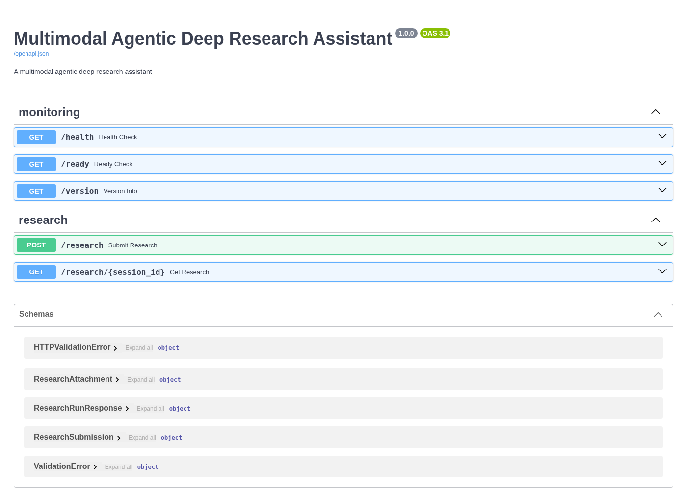
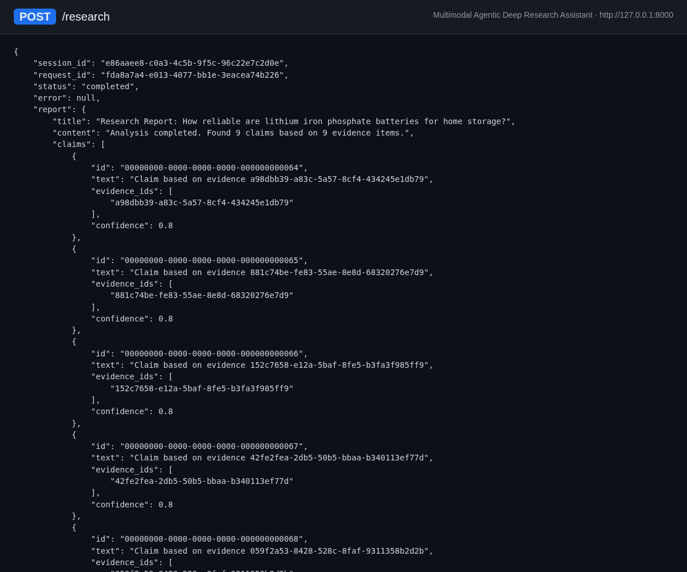
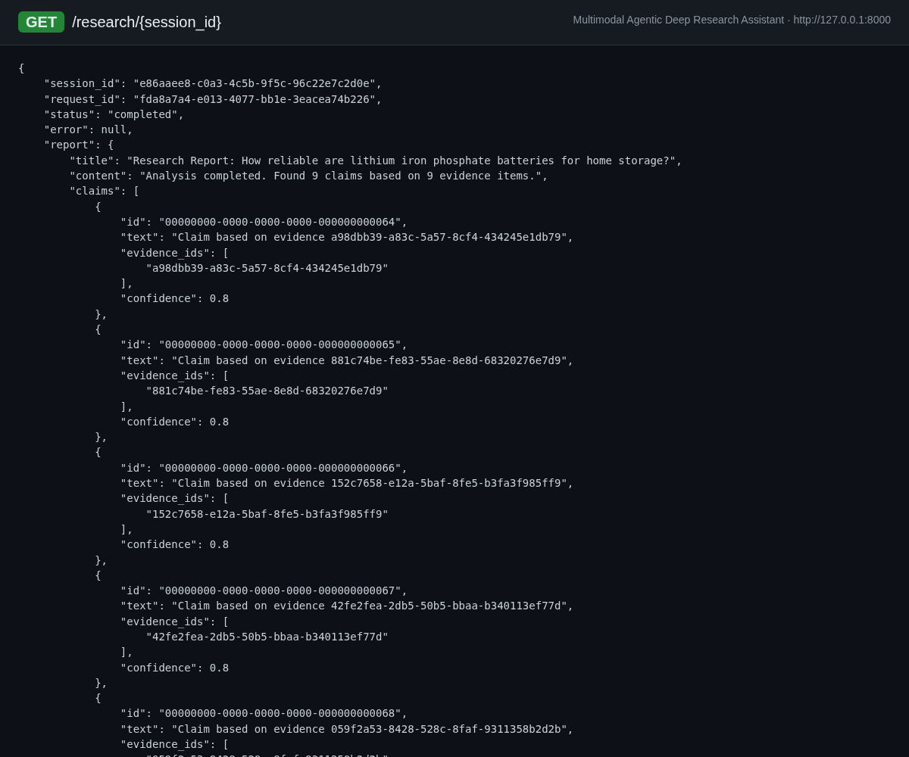
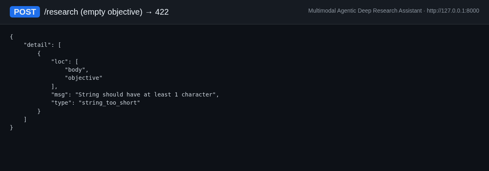
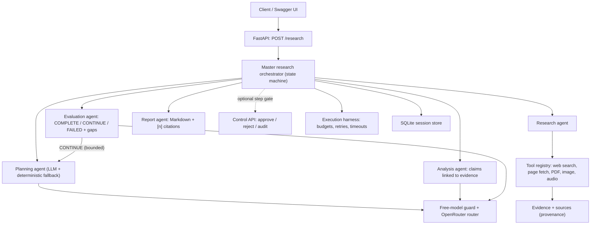

# Multimodal Agentic Deep Research Assistant

**An agentic research engine that plans, searches, reads PDFs and images, writes cited reports, and checks its own work. It uses free models only.**

You give it a research question, and optionally a PDF or an image. It plans the research, runs the right tools, collects evidence, writes a Markdown report with numbered citations, and then judges whether the report is good enough. If the report is not good enough, it replans and goes again, within strict budgets. Offline mode needs no keys and makes no network calls. Live mode uses free OpenRouter models and free search sources.

**Version:** v1.0.0 | **Python:** 3.11–3.13 | **Tests:** 347 passing | **License:** MIT | **Cost to run tests:** $0

[](https://github.com/LeelaissakAttota/multimodal-agentic-deep-research-assistant/actions/workflows/quality.yml)


[Architecture](docs/ARCHITECTURE.md) | [Live mode reference](docs/LIVE_MODE.md) | [Control API](docs/CONTROL_API.md) | [Demo guide](docs/DEMO.md) | [Windows setup](docs/SETUP_WINDOWS.md) | [Demo data](examples/demo-data/README.md)

## The problem it solves

"Deep research" assistants are easy to demo but hard to trust. They can loop without end, make up sources, leak keys into logs, or quietly run up a paid API bill. This project treats research as a bounded, auditable workflow:

- every claim links back to evidence, and every piece of evidence links back to a source
- every loop has a limit: research iterations, tool and model calls, tokens, time, and retries
- every model call goes through a guard that allows only `:free` models
- a human can supervise a run step by step and approve or reject each step before it runs

## See it working

<!-- DEMO VIDEO LINK: replace both occurrences of https://VIDEO_LINK below with the shared video link
     (for a Drive file use https://drive.google.com/file/d/<FILE_ID>/preview so it plays directly). -->
[](https://VIDEO_LINK)

▶ [Watch the Deep Research demo video](https://VIDEO_LINK)
<!-- END DEMO VIDEO LINK -->

| Swagger UI | `POST /research` |
| --- | --- |
|  |  |
| All endpoints, with interactive "Try it out" calls. | A completed run: report, claims linked to evidence IDs, and runtime accounting. |

| `GET /research/{session_id}` | Validation (422) |
| --- | --- |
|  |  |
| Fetch the finished result of a session by its ID. | Invalid input is rejected, and the submitted value is never echoed back. |

## What I built

- **Agent pipeline:** separate planning, research, analysis, evaluation and report agents, coordinated by an explicit state machine. The evaluator returns COMPLETE, CONTINUE or FAILED, plus the gaps it found. CONTINUE triggers a bounded replan.
- **LLM agents with deterministic fallback:** `LlmPlanningAgent` and `LlmEvaluationAgent` strictly validate the model's JSON. If a call hits a rate limit, a timeout, invalid JSON or a schema error, the deterministic agent makes that one decision instead, and the decision log records it.
- **Live research on free sources:** search with automatic fallback (optional Tavily, then DuckDuckGo HTML and Lite, Wikipedia, and the DuckDuckGo Instant Answer API). Pages are fetched with SSRF and size protection. Synthesis uses `[n]` citations and a `## Sources` list.
- **Automatic free-model selection:** reads the OpenRouter catalog, keeps only `:free` models, probes the top candidates, and saves the fastest one to a cache. A model that fails is demoted and the next one is tried. `FreeModelGuard` rejects any model that is not free.
- **Multimodal inputs:** PDF text extraction with pypdf (scanned PDFs are handled without failing the run), image validation and description with a free vision model, and an audio transcription tool with a free speech-to-text router. Attachments are cited first, as primary sources.
- **Supervised-control API:** a local, token-protected API to start, pause, resume and stop runs and to approve, reject or retry steps. Low-risk steps can be auto-approved, and every decision goes to an audit log. Keys are write-only and shown masked.
- **Safe operations:** structured or plain-text logs with secret redaction, 422 responses that never echo the submitted input, HTTP and crash context in logs, and research lifecycle events.
- **Reliability:** transactional SQLite session persistence and recovery, retries, timeouts, budgets, an emergency stop, and ordered model fallback.
- **Repeatable validation:** 347 offline tests (unit, integration and adversarial), Ruff, strict MyPy, and a GitHub Actions matrix on Python 3.11, 3.12 and 3.13. There is also a Dockerfile.

## How it works



Research iterations, tool retries, model fallback and recovery are separate loops, and each has its own limit. Provider SDKs and SQLite never reach the agent or domain code directly. See [docs/ARCHITECTURE.md](docs/ARCHITECTURE.md) and [docs/DECISIONS.md](docs/DECISIONS.md).

### Design decisions and tradeoffs

| Decision | Why it helps | Tradeoff |
| --- | --- | --- |
| Free models only, enforced by a guard | Mistakes can never cost money | Free models are slower and rate-limited, so fallback is required |
| Deterministic fallback for every LLM decision | A run always finishes, even when the model fails | Fallback decisions are simpler than LLM ones |
| Hard limits on every loop | No endless loops or surprise bills | Very broad questions may hit the limits |
| Attachments cited before web results | The user's own documents come first | Weak attachments can crowd out better web sources |
| Offline deterministic test suite | Fast, free and reproducible CI | Live behaviour is checked by hand, not in CI |

## Quick start

> **Windows:** see [docs/SETUP_WINDOWS.md](docs/SETUP_WINDOWS.md) for a PowerShell step-by-step guide.

```bash
git clone https://github.com/LeelaissakAttota/multimodal-agentic-deep-research-assistant.git
cd multimodal-agentic-deep-research-assistant
python -m pip install -e ".[test]"
cp .env.example .env          # optional; offline mode needs no keys

deep-research-demo            # offline, deterministic demo (JSON output)
uvicorn deep_research.api.main:app --host 127.0.0.1 --port 8000
# open http://127.0.0.1:8000/docs
curl -X POST http://127.0.0.1:8000/research -H "Content-Type: application/json" -d @examples/sample_request.json
```

### Live mode (free)

```bash
export DEEP_RESEARCH_RESEARCH_MODE=live
export DEEP_RESEARCH_OPENROUTER_API_KEY=...      # free OpenRouter key; models are chosen automatically
uvicorn deep_research.api.main:app --port 8000
```

Without an OpenRouter key, live mode still returns real search evidence, with a snippet summary in place of the synthesis. Full details, including model selection, the search chain, PDF and image limits, and report sections, are in [docs/LIVE_MODE.md](docs/LIVE_MODE.md).

### PDF and image attachments

`POST /research` accepts up to 5 attachments, each `{"kind": "pdf" | "image", "data": "data:<mime>;base64,...", "name": "optional"}`. Ready-made requests with a fictional PDF and chart are in [examples/demo-data](examples/demo-data/README.md).

### Supervised control

```bash
export DEEP_RESEARCH_CONTROL_TOKEN="$(python -c 'import secrets;print(secrets.token_urlsafe(32))')"
deep-research-control --port 8711     # binds to 127.0.0.1 only
```

See [docs/CONTROL_API.md](docs/CONTROL_API.md) for the endpoints, approval gates and key handling.

### Docker

```bash
docker build -t deep-research .
docker run --rm -p 8000:8000 deep-research                 # offline
docker run --rm -p 8000:8000 --env-file .env deep-research # e.g. live mode
```

## API

| Endpoint | Purpose |
| --- | --- |
| `GET /health`, `/ready`, `/version` | Monitoring |
| `POST /research` | Run research on an objective (at most 10,000 characters) with optional metadata and attachments |
| `GET /research/{session_id}` | Fetch a finished result (the last 100 sessions are kept in memory) |

The input rules are strict: unknown fields, secret-like metadata, null characters, oversized metadata and non-finite numbers are all rejected. The OpenAPI spec is in [docs/openapi.json](docs/openapi.json), and more examples are in [docs/API-EXAMPLES.md](docs/API-EXAMPLES.md).

## Runtime limits

These are set with `DEEP_RESEARCH_*` environment variables. The defaults are:

- 3 research iterations
- tool calls: 20 per iteration and 60 per session
- model calls: 15 per iteration and 45 per session
- tokens: 4,000 per call and 50,000 per session
- time: 300 seconds per session, 30 seconds per tool call and 60 seconds per model call
- 2 retries per operation

`DEEP_RESEARCH_EMERGENCY_STOP=true` stops the run before the next operation. Every setting is listed in [.env.example](.env.example).

## Validate

```bash
pytest          # 347 tests, offline, $0
ruff check .
mypy src
```

## Repository map

| Path | Contents |
| --- | --- |
| `src/deep_research/api` | FastAPI app, research service, error handlers |
| `src/deep_research/core` | agents, orchestrator, step gate, config, free-model guard |
| `src/deep_research/control` | supervised-control API, run manager, risk rules, secret store |
| `src/deep_research/tools` | web search and fetch, PDF, image, audio tools, registry and selector |
| `src/deep_research/models` | OpenRouter gateway, catalog, routing, speech-to-text router |
| `src/deep_research/{evidence,domain,persistence,runtime,memory,context,observability,security}` | contracts, storage, budgets, logging and redaction |
| `tests/unit`, `tests/integration` | offline tests |
| `docs/` | architecture, decisions, policies, live mode, control API, setup, images |
| `examples/` | sample request and response, demo output, ZetaCell demo data |

## Security and limitations

- Never commit `.env`, keys, runtime databases, logs or generated research. See [SECURITY.md](SECURITY.md) and [docs/SECURITY_GUIDELINES.md](docs/SECURITY_GUIDELINES.md).
- Results are kept in memory by a single process. A durable or multi-worker deployment would need the existing `ResearchSessionRepository` boundary connected to the API.
- Retrieval is lexical, not embedding-based, and token limits are counted in characters.
- Free models can be slow or rate-limited. Live answers depend on whichever free model and search source respond at the time.

## License

MIT. See [LICENSE](LICENSE). © 2026 Attota Leelaissak.
