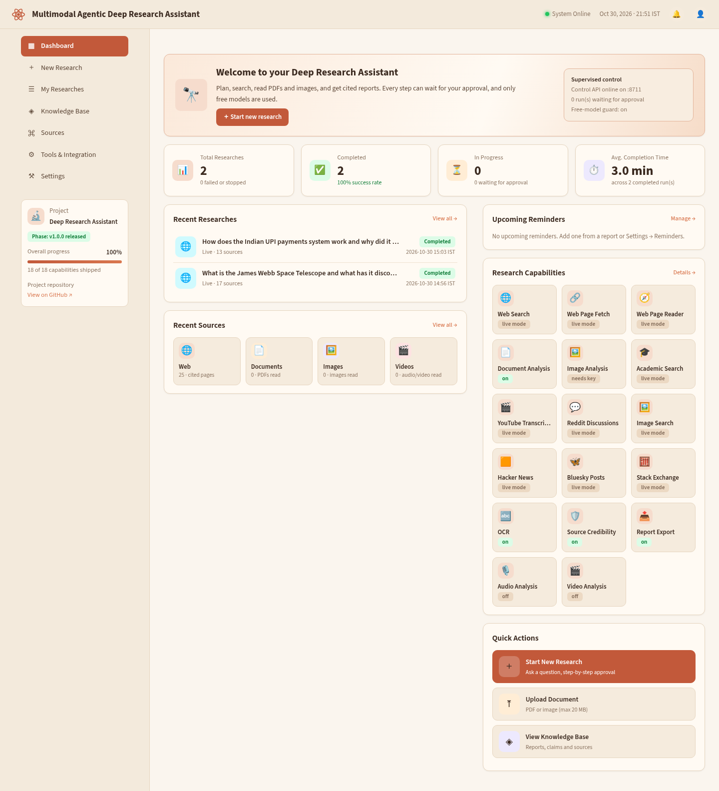
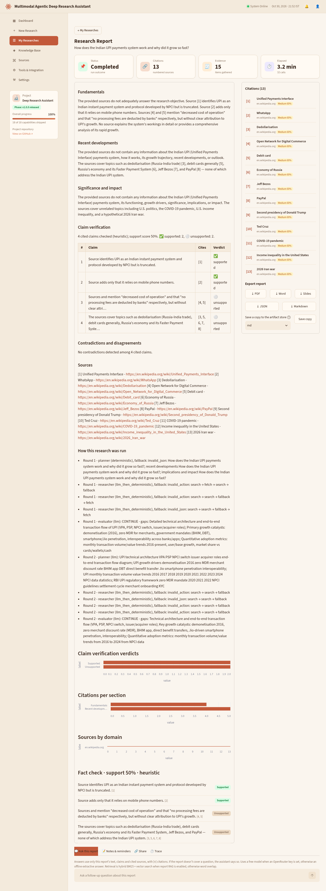
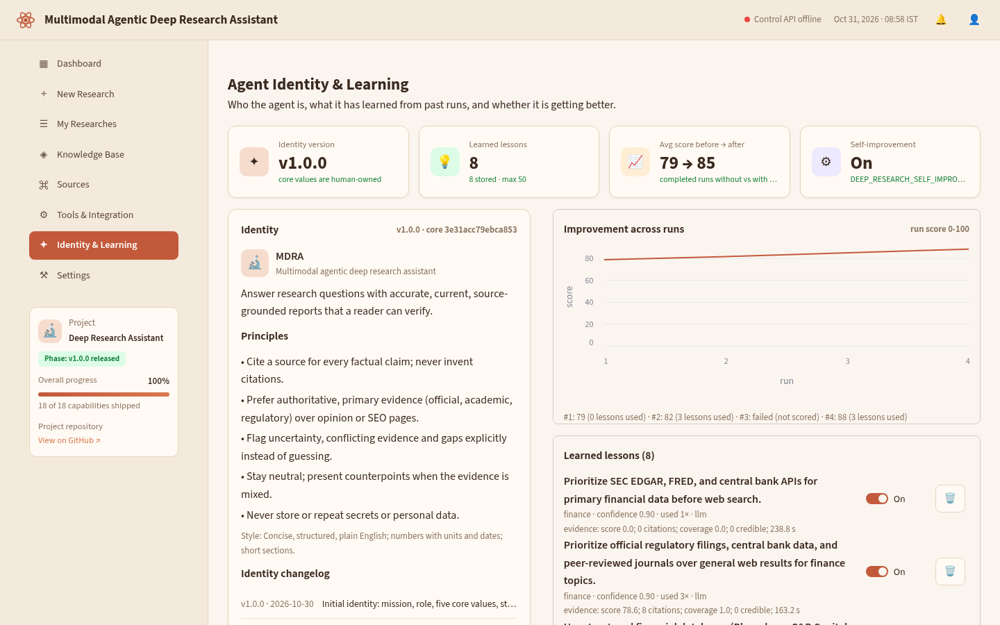
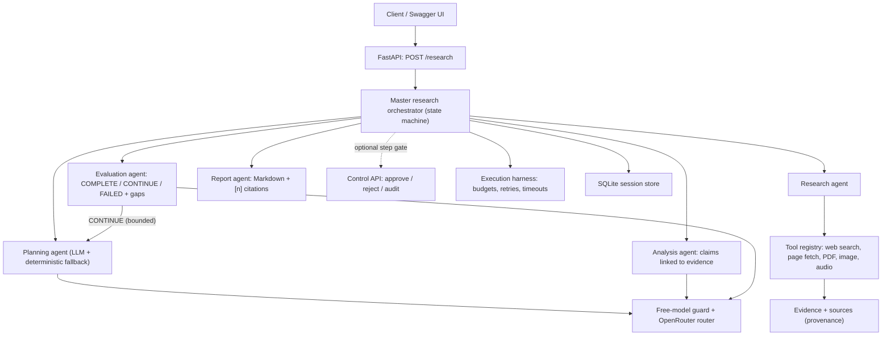

# Multimodal Agentic Deep Research Assistant

**An agentic research engine that plans, searches, reads PDFs and images, writes cited reports, and checks its own work. It uses free models only.**

You give it a research question, and optionally a PDF or an image. It plans the research, runs the right tools, collects evidence, writes a Markdown report with numbered citations, and then judges whether the report is good enough. If the report is not good enough, it replans and goes again, within strict budgets. Offline mode needs no keys and makes no network calls. Live mode uses free OpenRouter models and free search sources.

**Version:** v1.0.0 | **Python:** 3.11–3.13 | **Tests:** 1242 tests (1230 passing, 12 skipped without optional services) | **License:** MIT | **Cost to run tests:** $0

[](https://github.com/LeelaissakAttota/multimodal-agentic-deep-research-assistant/actions/workflows/quality.yml)


[Architecture](docs/ARCHITECTURE.md) | [Live mode reference](docs/LIVE_MODE.md) | [Control API](docs/CONTROL_API.md) | [Demo guide](docs/DEMO.md) | [Windows setup](docs/SETUP_WINDOWS.md) | [Demo data](examples/demo-data/README.md)

## The problem it solves

"Deep research" assistants are easy to demo but hard to trust. They can loop without end, make up sources, leak keys into logs, or quietly run up a paid API bill. This project treats research as a bounded, auditable workflow:

- every claim links back to evidence, and every piece of evidence links back to a source
- every loop has a limit: research iterations, tool and model calls, tokens, time, and retries
- every model call goes through a guard that allows only `:free` models
- a human can supervise a run step by step and approve or reject each step before it runs

## See it working

<!-- DEMO VIDEO LINK: replace both occurrences of https://VIDEO_LINK below with the shared video link
     (for a Drive file use https://drive.google.com/file/d/<FILE_ID>/preview so it plays directly). -->
[](https://VIDEO_LINK)

▶ [Watch the Deep Research demo video](https://VIDEO_LINK)
<!-- END DEMO VIDEO LINK -->

| Swagger UI | `POST /research` |
| --- | --- |
|  |  |
| All endpoints, with interactive "Try it out" calls. | A completed run: report, claims linked to evidence IDs, and runtime accounting. |

| `GET /research/{session_id}` | Validation (422) |
| --- | --- |
|  |  |
| Fetch the finished result of a session by its ID. | Invalid input is rejected, and the submitted value is never echoed back. |

### Dashboard

| Dashboard | Report view |
| --- | --- |
|  |  |
| Recent runs, sources, capabilities and quick actions. | Report, claims linked to evidence, verification and exports. |



*Identity & Learning:* the agent's fixed identity, the lessons it learned from earlier runs, and the score of completed
runs without vs with those lessons (failed runs are listed but not averaged).

## What I built

- **Agent pipeline:** separate planning, research, analysis, evaluation and report agents, coordinated by an explicit state machine. The evaluator returns COMPLETE, CONTINUE or FAILED, plus the gaps it found. CONTINUE triggers a bounded replan.
- **LLM agents with deterministic fallback:** `LlmPlanningAgent` and `LlmEvaluationAgent` strictly validate the model's JSON. If a call hits a rate limit, a timeout, invalid JSON or a schema error, the deterministic agent makes that one decision instead, and the decision log records it.
- **Live research on free sources:** search with automatic fallback (optional Tavily, then DuckDuckGo HTML and Lite, Wikipedia, and the DuckDuckGo Instant Answer API). Pages are fetched with SSRF and size protection. Synthesis uses `[n]` citations and a `## Sources` list.
- **Automatic free-model selection:** reads the OpenRouter catalog, keeps only `:free` models, probes the top candidates, and saves the fastest one to a cache. A model that fails is demoted and the next one is tried. `FreeModelGuard` rejects any model that is not free.
- **Public discussion and research sources (keyless, live mode):** arXiv / Semantic Scholar / OpenAlex papers, YouTube transcripts, Reddit, Hacker News (Algolia API), Stack Exchange Q&A (Stack Overflow, stats, math, physics, quant, money), Bluesky posts (public AppView, optional app-password login) and Wikimedia Commons images, routed by the planner with web-search fallback. See [docs/LIVE_MODE.md](docs/LIVE_MODE.md).
- **Multimodal inputs:** PDF text extraction with pypdf; DOCX, PPTX, TXT and Markdown parsing (stdlib, zip-bomb and XML-entity safe, page/slide citations); local OCR for images and scanned PDFs with RapidOCR (tesseract fallback, skipped cleanly when neither is installed); image description with a free vision model; web page URLs read through the SSRF-guarded fetcher (live mode); an audio transcription tool with a free speech-to-text router; and optional audio/video/YouTube analysis (off by default, `media` extra: faster-whisper transcripts, YouTube captions via yt-dlp, keyframes captioned by the vision model, cited by `mm:ss`; see docs/SCALE.md section 9). Attachments are cited first, as primary sources.
- **Trust signals:** every cited source gets a heuristic credibility score (government, academic and journal domains high; major news high; Wikipedia medium; blogs and user-generated platforms low; unknown domains "unverified"), and every cited statement in a report gets a confidence score from how many distinct sources back it, how credible they are, and whether the wording is hedged. Both are heuristics, not fact checks.
- **Exports and CLI:** reports download as PDF, DOCX, PPTX, JSON, Markdown or self-contained HTML from the dashboard and `GET /control/runs/{id}/export`, and a `deep-research` CLI runs one question end to end.
- **Assistant features (local):** follow-up chat on a finished report that answers only from that report's text, claims and cited sources (with `[n]` citations, refusing unsupported questions; free model optional, offline extractive fallback), a user profile (saved topics, preferred/blocked sources and domains, default depth) that the planner applies to every run, notes and due-date reminders per report, and revocable token-protected read-only share links plus self-contained HTML export. Stored in SQLite under the git-ignored `data/`. See [docs/ASSISTANT.md](docs/ASSISTANT.md).
- **Supervised-control API:** a local, token-protected API to start, pause, resume and stop runs and to approve, reject or retry steps. Low-risk steps can be auto-approved, and every decision goes to an audit log. Keys are write-only and shown masked.
- **Optional scale backends (all off by default, all free/local):** RQ job queue on Redis with a Windows-safe worker, Postgres session storage with a migration tool, MinIO/S3 artifact storage, OpenTelemetry tracing with secret-free spans, deterministic A/B experiments on planner/prompt variants compared in the evaluation suite, a claims-and-sources knowledge graph (local, optional Neo4j sync) and a Chrome MV3 extension that sends pages to the local control API. The dashboard shows each backend's real status. See [docs/SCALE.md](docs/SCALE.md).
- **Safe operations:** structured or plain-text logs with secret redaction, 422 responses that never echo the submitted input, HTTP and crash context in logs, and research lifecycle events.
- **Reliability:** transactional SQLite session persistence and recovery, retries, timeouts, budgets, an emergency stop, and ordered model fallback.
- **Repeatable validation:** 1230 offline tests (unit, integration and adversarial), Ruff, strict MyPy, and a GitHub Actions matrix on Python 3.11, 3.12 and 3.13. There is also a Dockerfile.

## How it works



Research iterations, tool retries, model fallback and recovery are separate loops, and each has its own limit. Provider SDKs and SQLite never reach the agent or domain code directly. See [docs/ARCHITECTURE.md](docs/ARCHITECTURE.md) and [docs/DECISIONS.md](docs/DECISIONS.md).

### Design decisions and tradeoffs

| Decision | Why it helps | Tradeoff |
| --- | --- | --- |
| Free models only, enforced by a guard | Mistakes can never cost money | Free models are slower and rate-limited, so fallback is required |
| Deterministic fallback for every LLM decision | A run always finishes, even when the model fails | Fallback decisions are simpler than LLM ones |
| Hard limits on every loop | No endless loops or surprise bills | Very broad questions may hit the limits |
| Attachments cited before web results | The user's own documents come first | Weak attachments can crowd out better web sources |
| Offline deterministic test suite | Fast, free and reproducible CI | Live behaviour is checked by hand, not in CI |

## Quick start

> **Windows:** see [docs/SETUP_WINDOWS.md](docs/SETUP_WINDOWS.md) for a PowerShell step-by-step guide.

```bash
git clone https://github.com/LeelaissakAttota/multimodal-agentic-deep-research-assistant.git
cd multimodal-agentic-deep-research-assistant
python -m venv .venv && . .venv/bin/activate   # Windows: .venv\Scripts\Activate.ps1
python -m pip install -e ".[test,dashboard]"   # add ,export,ocr for report exports and local OCR
cp .env.example .env          # optional; offline mode needs no keys

deep-research-demo            # offline, deterministic demo (JSON output)
uvicorn deep_research.api.main:app --host 127.0.0.1 --port 8000
# open http://127.0.0.1:8000/docs
curl -X POST http://127.0.0.1:8000/research -H "Content-Type: application/json" -d @examples/sample_request.json

# Dashboard: control API on :8711 + Streamlit UI on :8502 (Windows: scripts\start-dashboard.ps1)
scripts/start-dashboard.sh    # then open http://127.0.0.1:8502
```

### Live mode (free)

```bash
export DEEP_RESEARCH_RESEARCH_MODE=live
export DEEP_RESEARCH_OPENROUTER_API_KEY=...      # free OpenRouter key; models are chosen automatically
uvicorn deep_research.api.main:app --port 8000
```

Without an OpenRouter key, live mode still returns real search evidence, with a snippet summary in place of the synthesis. Full details, including model selection, the search chain, PDF and image limits, and report sections, are in [docs/LIVE_MODE.md](docs/LIVE_MODE.md).

### Attachments

`POST /research` accepts up to 5 attachments, each `{"kind": "pdf" | "image" | "document" | "url", "data": "...", "name": "optional"}`. For files, `data` is `data:<mime>;base64,...` (`document` covers DOCX, PPTX, TXT and Markdown). For `url`, `data` is a public `http(s)` page link; it is read in live mode only, through the same SSRF guard as web fetches (private and loopback addresses and redirects to them are refused). Images and scanned PDFs are OCR'd locally when `pip install -e ".[ocr]"` is installed (`DEEP_RESEARCH_OCR=off` disables it). Ready-made requests with a fictional PDF and chart are in [examples/demo-data](examples/demo-data/README.md).

### Command line

```bash
pip install -e ".[export]"                  # fpdf2, python-docx, python-pptx for --export pdf|docx|pptx
deep-research run "How do SMRs compare on cost?" --mode live \
    --file notes.docx --file https://www.energy.gov/ne/benefits-small-modular-reactors-smrs \
    --export pdf --export json --out reports/
```

`--file` takes a PDF, image, DOCX, PPTX, TXT/MD path or a web page URL (repeatable, max 5). `--mode` is `offline` (no network) or `live`. The Markdown report goes to stdout (or the full result with `--json`); status goes to stderr; the exit code is 0 only for a completed run.

### Exports

Finished runs export as `pdf`, `docx`, `pptx`, `json`, `md` or `html` (self-contained, inline CSS, no scripts): from the report page in the dashboard, with `GET /control/runs/{id}/export?format=pdf` on the control API, or with `deep-research run ... --export pdf`. Exports include the report body and tables, numbered sources with credibility, and claim confidence. A missing optional library returns 501 with the pip command.

### Supervised control

```bash
export DEEP_RESEARCH_CONTROL_TOKEN="$(python -c 'import secrets;print(secrets.token_urlsafe(32))')"
deep-research-control --port 8711     # binds to 127.0.0.1 only
```

See [docs/CONTROL_API.md](docs/CONTROL_API.md) for the endpoints, approval gates and key handling.

### Assistant: follow-up chat, profile, notes, reminders, sharing

On a report page in the dashboard: **Ask this report** (grounded Q&A with citations; unsupported questions are refused), **Notes & reminders**, and **Share** (HTML download, or a read-only link `http://127.0.0.1:8711/share/<id>?token=...` that you can revoke). **Settings → Profile & Preferences** sets saved topics, preferred/blocked sources, blocked domains and default depth (quick / standard / deep) for every new run; **Dashboard** lists upcoming reminders. Reminders are local only: nothing is emailed or pushed. Data lives in `data/assistant.db` (override with `DEEP_RESEARCH_ASSISTANT_DB`). Details: [docs/ASSISTANT.md](docs/ASSISTANT.md).

### Phase 7: RAG chat, media, GraphRAG and run traces (all opt-in)

| Feature | Turn it on | What you get |
|---|---|---|
| Hybrid RAG chat | `MDRA_RAG_ENABLED=true`, `rag` extra, `deep-research rag-backfill` | BM25 + vector retrieval (local FAISS/numpy or pgvector) for "Ask this report" and the Knowledge Base, with `[n]` citations |
| Audio / video / YouTube | `MDRA_MEDIA_ENABLED=true`, `media` extra | faster-whisper transcripts or YouTube captions, keyframes captioned by a free vision model, cited by `mm:ss` |
| GraphRAG | `MDRA_GRAPH_RAG=true` (Neo4j optional via `MDRA_NEO4J_URI`, `graph` extra) | chat hits expanded through contradicting, shared-source and shared-entity claims; local graph fallback |
| Trace timeline | `MDRA_TRACE_STORE=sqlite` (`tracing` extra) | a **⏱ Trace** waterfall tab per run with redacted spans |

Speed: when step-by-step approval is off, a plan's independent research tasks run concurrently (about 4x faster per iteration in live tests), and if another iteration would exhaust the time budget the report is written from the evidence already gathered. Linux/macOS: `scripts/start-dashboard.sh` starts the control API and dashboard.

### Agent identity and self-improvement (on by default, fully local)

The agent has a versioned identity in [`config/agent_identity.yaml`](config/agent_identity.yaml): name, role, mission,
core principles (cite every claim, prefer authoritative evidence, flag uncertainty) and style. It is injected at the
top of the planner, analysis and writer prompts. The core is human-owned: the agent cannot edit it, and every
version/core hash it runs with is logged (identity changelog). Only *lessons* and *tool reliability stats* evolve.

How the agent improves itself after every run, with no human in the loop (`src/deep_research/learning/`):

1. **Score.** A reflection step scores the run 0-100 from signals it already has: citation count and claim coverage,
   source credibility, failed or slow tools, run time, the evaluator's quality scores and user feedback when present.
2. **Reflect.** The configured LLM writes 1-3 short, reusable lessons ("for finance questions, prefer SEC filings and
   central-bank data"; "tool X timed out, lower its priority"). Without a model, deterministic rules write them.
3. **Validate and store.** Lessons go to a local SQLite store (`data/learning.db`) with evidence, run id, timestamp,
   confidence and usage count. Secrets and personal data are rejected, near-duplicates reinforce the existing lesson,
   a contradicting lesson lowers the old one, confidence decays when a lesson is not used, and low-confidence lessons
   are pruned under a hard cap (`DEEP_RESEARCH_SELF_IMPROVEMENT_MAX_LESSONS`, default 50).
4. **Apply.** Before planning, the top-k relevant lessons (keyword + topic match weighted by confidence, optional
   embedding re-score) are injected into the planner prompt, and live source tools are re-ranked by measured success
   rate and latency; a tool under 25% success after 3+ calls is skipped.
5. **Show.** The dashboard's *Identity & Learning* page has the identity card, the lessons (with evidence, confidence,
   on/off toggle and delete), the tool reliability table and the run-score chart (before vs after lessons).

Turn it off with `DEEP_RESEARCH_SELF_IMPROVEMENT=false`; `DEEP_RESEARCH_SELF_IMPROVEMENT_TOP_K` (3) sets how many
lessons a run uses.

**In one sentence:** every run is graded on evidence the system already measures, a reflection agent turns
that grade into a few validated lessons in a local memory, and the next similar question retrieves those lessons
(the same RAG idea used for documents) and steers planning and tool choice, while the core identity stays fixed and
auditable.

### Docker

```bash
docker build -t deep-research .
docker run --rm -p 8000:8000 deep-research                 # offline
docker run --rm -p 8000:8000 --env-file .env deep-research # e.g. live mode
```

### Scaling (optional)

Nothing changes unless you opt in: SQLite, local files and in-process runs stay the default. `docker compose up -d` starts local Redis, Postgres, MinIO and an OpenTelemetry collector (Neo4j with `--profile graph`), all on `127.0.0.1`; then set the `MDRA_*` variables you want and install the matching extras (`queue`, `postgres`, `s3`, `tracing`, `graph`). Run queued research with `deep-research-worker` (SimpleWorker on Windows), move sessions with `deep-research-migrate`, compare A/B variants with `deep-research-eval --by-variant`, and load `extensions/mdra-chrome` as an unpacked extension. Details: [docs/SCALE.md](docs/SCALE.md). Optional report RAG (hybrid BM25 + vector retrieval for the follow-up chat and Knowledge Base, pgvector or local FAISS/numpy, `deep-research rag-backfill`) is off by default: set `MDRA_RAG_ENABLED=true` and install the `rag` extra; see docs/SCALE.md section 8. Audio/video analysis is likewise opt-in: `MDRA_MEDIA_ENABLED=true` plus the `media` extra (section 9).

## API

| Endpoint | Purpose |
| --- | --- |
| `GET /health`, `/ready`, `/version` | Monitoring |
| `POST /research` | Run research on an objective (at most 10,000 characters) with optional metadata and attachments |
| `GET /research/{session_id}` | Fetch a finished result (the last 100 sessions are kept in memory) |

The input rules are strict: unknown fields, secret-like metadata, null characters, oversized metadata and non-finite numbers are all rejected. The OpenAPI spec is in [docs/openapi.json](docs/openapi.json), and more examples are in [docs/API-EXAMPLES.md](docs/API-EXAMPLES.md).

## Runtime limits

These are set with `DEEP_RESEARCH_*` environment variables. The defaults are:

- 3 research iterations
- tool calls: 20 per iteration and 60 per session
- model calls: 15 per iteration and 45 per session
- tokens: 4,000 per call and 50,000 per session
- time: 300 seconds per session, 30 seconds per tool call and 60 seconds per model call
- 2 retries per operation

`DEEP_RESEARCH_EMERGENCY_STOP=true` stops the run before the next operation. Every setting is listed in [.env.example](.env.example).

## Validate

```bash
pytest          # 1242 tests: 1230 passing + 12 optional-service skips, offline, $0
ruff check .
mypy src
```

## Repository map

| Path | Contents |
| --- | --- |
| `src/deep_research/api` | FastAPI app, research service, error handlers |
| `src/deep_research/core` | agents, orchestrator, step gate, config, free-model guard |
| `src/deep_research/control` | supervised-control API, run manager, risk rules, secret store |
| `src/deep_research/tools` | web search and fetch, web page reader, PDF, document, image, OCR, audio tools, registry and selector |
| `src/deep_research/export`, `src/deep_research/cli.py` | PDF/DOCX/PPTX/JSON/Markdown/HTML report export, `deep-research` CLI |
| `src/deep_research/assistant` | report follow-up chat, profile and preferences, notes and reminders, share links (local SQLite) |
| `src/deep_research/scale` | optional backends: job queue, artifact storage, tracing, A/B experiments, knowledge graph, migration, status |
| `extensions/mdra-chrome` | Chrome MV3 extension (send page or selection to the local control API) |
| `docker-compose.yml`, `deploy/otel` | local Redis, Postgres, MinIO, OpenTelemetry collector, Neo4j (all optional) |
| `src/deep_research/models` | OpenRouter gateway, catalog, routing, speech-to-text router |
| `src/deep_research/{evidence (incl. credibility and claim scoring),domain,persistence,runtime,memory,context,observability,security}` | contracts, storage, budgets, logging and redaction |
| `tests/unit`, `tests/integration` | offline tests |
| `docs/` | architecture, decisions, policies, live mode, control API, setup, images |
| `examples/` | sample request and response, demo output, ZetaCell demo data |

## Security and limitations

- Never commit `.env`, keys, runtime databases, logs or generated research. See [SECURITY.md](SECURITY.md) and [docs/SECURITY_GUIDELINES.md](docs/SECURITY_GUIDELINES.md).
- The public `/research` API keeps results in memory in a single process. Control-API runs can use the optional Redis job queue and Postgres session storage (docs/SCALE.md); the assistant database stays on SQLite.
- Retrieval is lexical, not embedding-based, and token limits are counted in characters.
- Credibility and claim confidence are domain and citation heuristics. They flag weak sourcing; they do not verify facts.
- OCR quality depends on scan quality; RapidOCR's bundled models are tuned for English and Chinese text.
- Free models can be slow or rate-limited. Live answers depend on whichever free model and search source respond at the time.

## License

MIT. See [LICENSE](LICENSE). © 2026 Attota Leelaissak.
